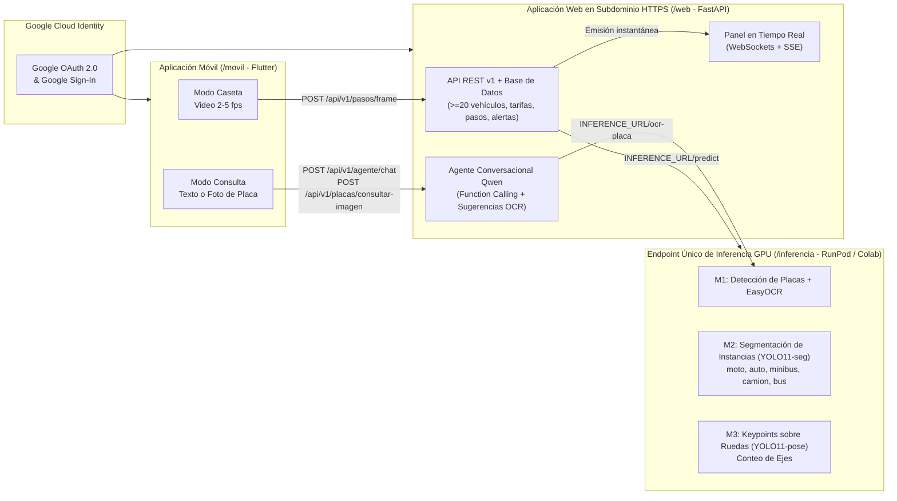

# 🐍 Laboratorio 3 - Sistema Inteligente de Control de Peaje
**IAM-811 Machine Learning y Aprendizaje Profundo** · Laboratorio Final de Hito

Sistema integral de control de peaje en la nube basado en visión por computadora que integra **tres modelos de Deep Learning en un único endpoint GPU (RunPod / Google Colab)**, una **aplicación web en tiempo real** con **autenticación exclusiva de Google OAuth 2.0 (Lista Blanca)**, un **Agente Conversacional con Qwen (Function Calling)** y una **aplicación móvil en Flutter** con modos Caseta y Consulta.

---

## 1. Integrantes y Roles

| Integrante | Correo Google Autorizado (Lista Blanca) | Rol en el Sistema | Responsabilidad en el Proyecto |
|---|---|---|---|
| **Jhair Pinto** | `jhairpinto8@gmail.com` | Administrador | Arquitectura, Entrenamiento (M1/M2/M3), Endpoint de Inferencia GPU, Aplicación Web/API, Agente Conversacional Qwen y App Móvil |
| **Ing. Alvaro Pinto Mamani** | `doc.alvaro.pinto.ma@unifranz.edu.bo` | Administrador (Docente) | Cuenta oficial del docente pre-autorizada con rol de Administrador (Sección 4.4 y 7.3) |

---

## 2. Arquitectura del Sistema



La aplicación web no depende de dónde corre la inferencia: la URL del servidor GPU se define en `INFERENCE_URL` (o se actualiza en vivo desde la pestaña **Estado GPU** del panel web), permitiendo alternar entre **RunPod** y **Google Colab** sin tocar el código.

---

## 3. Tecnologías Utilizadas

- **Modelos de Visión por Computadora:** Ultralytics `YOLO11-seg` (M2 Segmentación de instancias), `YOLO11-pose` (M3 Keypoints de ruedas $\rightarrow$ conteo de ejes), `YOLO` detector de placas + `EasyOCR` + normalización contextual boliviana (M1), `OpenCV` y `PyTorch 2.4` con `CUDA`.
- **Gestión de Datasets y Entrenamiento:** **Roboflow** (etiquetado de polígonos de máscara y keypoints de ruedas) y **Google Colab (GPU Tesla T4)**.
- **Servidor de Inferencia (`/inferencia`):** **FastAPI** + `Uvicorn` con bloqueo de concurrencia GPU (`threading.Lock`), desplegable en **RunPod** (`proxy.runpod.net`) o **Google Colab** (`trycloudflare.com`).
- **Aplicación Web, API REST y Tiempo Real (`/web`):** **FastAPI**, **SQLAlchemy** (SQLite / PostgreSQL), **WebSockets** + **Server-Sent Events (SSE)**, interfaz moderna con **Tailwind CSS**, y documentación **OpenAPI / Swagger** automática en `/docs`.
- **Autenticación:** **Google OAuth 2.0 / Google Identity Services** con validación de **Lista Blanca** en base de datos y control de roles (`administrador` y `operador`).
- **Agente Conversacional:** **Qwen (`qwen-plus` / `Qwen2.5`)** vía API Key con **Function Calling** sobre la base de datos y motor de distancia de edición para sugerencias de errores OCR (`O↔0`, `I↔1`, `B↔8`, `S↔5`).
- **Aplicación Móvil (`/movil`):** **Flutter** (`camera`, `google_sign_in`, `image_picker`, `http`).

---

## 4. Estructura del Repositorio

```text
├── .env.example                 # Plantilla de variables de entorno (sin secretos expuestos)
├── README.md                    # Documentación general, arquitectura e instrucciones de despliegue
├── entrenamiento/               # Notebooks de Colab para entrenar M2 y M3 y validar M1+OCR
│   ├── 01_M1_placas_y_ocr_validacion.ipynb
│   ├── 02_M2_segmentacion_vehiculos_entrenamiento.ipynb
│   ├── 03_M3_keypoints_ruedas_ejes_entrenamiento.ipynb
│   ├── diagnosticar_entorno.py  # Script de diagnóstico (+5 pts Gestión de Entornos)
│   ├── environment.yml          # Entorno Conda/Mamba con versiones fijadas
│   └── requirements.txt         # Dependencias pip con versiones fijadas
├── inferencia/                  # Endpoint único de los 3 modelos (M1 + M2 + M3)
│   ├── app_inferencia.py        # Servidor FastAPI unificado (/health, /predict, /ocr-placa, /ws)
│   ├── servidor_inferencia_runpod.ipynb
│   ├── servidor_inferencia_colab.ipynb
│   ├── Dockerfile
│   ├── diagnosticar_entorno.py
│   ├── environment.yml
│   └── requirements.txt
├── web/                         # Aplicación web en subdominio, API REST, BD, tiempo real y Agente Qwen
│   ├── main.py                  # Servidor principal FastAPI + rutas /api/v1/* + WebSockets + SSE
│   ├── models.py                # Tablas: usuarios, vehiculos, casetas, tarifas, pasos, alertas
│   ├── seed.py                  # Poblado inicial (>=20 vehículos, tarifas, casetas, admin docente)
│   ├── auth.py                  # Validación Google OAuth 2.0, roles y lista blanca
│   ├── agent_qwen.py            # Agente conversacional Qwen con Function Calling y 4 estados
│   ├── ocr_utils.py             # Normalización de placas y sugerencias OCR (O↔0, I↔1, B↔8, S↔5)
│   ├── realtime.py              # Emisor en tiempo real WebSockets + SSE
│   ├── static/                  # Panel web SPA (Panel RT, Vehículos, Pasos, Alertas, Chat, Estado)
│   ├── Dockerfile
│   ├── diagnosticar_entorno.py
│   ├── environment.yml
│   └── requirements.txt
├── movil/                       # Aplicación móvil en Flutter (Google Sign-In, Modo Caseta y Consulta)
│   ├── pubspec.yaml
│   ├── lib/
│   └── README_MOVIL.md
└── docs/                        # Documentación OpenAPI/Postman, guía cloud y plantilla de informe
    ├── postman_collection.json
    ├── guia_despliegue_nube.md
    └── plantilla_informe_tecnico.md
```

---

## 5. Gestión de Entornos y Recreación de Servicios (Bonificación +5 puntos - Sección 10)

Cada servicio (`/entrenamiento`, `/inferencia`, `/web`) cuenta con sus archivos `environment.yml` y `requirements.txt` con **versiones fijadas** y su script `diagnosticar_entorno.py`.

### Opción A: Recrear entornos con Conda o Mamba (Miniforge)
```bash
# 1. Servicio de Entrenamiento
cd entrenamiento
conda env create -f environment.yml
conda activate peaje_entrenamiento
python diagnosticar_entorno.py entrenamiento

# 2. Servicio de Inferencia (RunPod / Servidor GPU)
cd ../inferencia
conda env create -f environment.yml
conda activate peaje_inferencia
python diagnosticar_entorno.py

# 3. Servicio Web, API y Agente Conversacional
cd ../web
conda env create -f environment.yml
conda activate peaje_web
python diagnosticar_entorno.py
```

### Opción B: Recrear entornos con `venv` de Python
```bash
# En /inferencia o /web:
python -m venv .venv
source .venv/bin/activate  # En Windows: .venv\Scripts\activate
pip install -r requirements.txt
python diagnosticar_entorno.py
```
El script `diagnosticar_entorno.py` genera los archivos `diagnostico_<servicio>.txt` y `.json` con las versiones exactas de Python, PyTorch, CUDA, GPU y Ultralytics para incluir en la carpeta en la nube.

---

## 6. Enlaces del Proyecto (Sección 7)

- **Subdominio de la Aplicación Web en Producción:** `https://peaje-ia.tudominio.com` *(Actualizar con la URL final del subdominio antes de entregar)*
- **Documentación Interactiva de la API (Swagger / OpenAPI):** `https://peaje-ia.tudominio.com/docs`
- **Endpoint de Inferencia GPU (`INFERENCE_URL`):** `https://<POD_ID>-8000.proxy.runpod.net` (RunPod) o `https://<TUNNEL>.trycloudflare.com` (Colab)
- **Dataset M2 (Segmentación de Vehículos en Roboflow):** `https://universe.roboflow.com/peaje-iam811/segmentacion-vehiculos-peaje`
- **Dataset M3 (Keypoints de Ruedas / Ejes en Roboflow):** `https://universe.roboflow.com/peaje-iam811/keypoints-ruedas-ejes`
