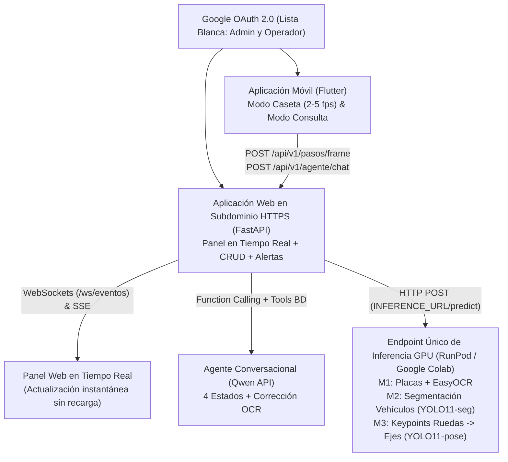

# Informe Técnico: Sistema Inteligente de Control de Peaje
**Asignatura:** IAM-811 Machine Learning y Aprendizaje Profundo  
**Docente:** Ing. Alvaro Pinto Mamani  
**Estudiante / Grupo:** Jhair Pinto (`jhairpinto8@gmail.com`)  

---

## 1. Arquitectura General del Sistema

El sistema implementa una arquitectura 100% en la nube, desacoplando la aplicación web/API respecto al servidor GPU de inferencia mediante la variable `INFERENCE_URL`:

---

## 2. Datasets Gestionados en Roboflow

| Modelo | Tarea | Clases | Cantidad de Imágenes | Aumentaciones Aplicadas en Roboflow / Colab |
|---|---|---|---|---|
| **M1** | Detección de Placas + EasyOCR | `placa` (1 clase) | Dataset proyecto anterior + validación OCR | Contraste CLAHE, variación de brillo $\pm 25\%$, rotación $\pm 10^\circ$ |
| **M2** | Segmentación de Instancias (`YOLO11-seg`) | `moto`, `auto`, `minibus`, `camion`, `bus` (5 clases) | Base Roboflow Universe + capturas propias etiquetadas con polígonos | Flip horizontal ($50\%$), Mosaic ($100\%$), variación HSV ($H=0.015, S=0.7, V=0.4$) |
| **M3** | Keypoints de Ruedas (`YOLO11-pose`) | `rueda_eje` / vehículo con keypoints en centros de rueda | Imágenes laterales/diagonales de vehículos ligeros y pesados | Flip horizontal, escalado $\pm 20\%$, oclusión parcial |

---

## 3. Entrenamiento y Métricas Alcanzadas

Los modelos se entrenaron en **Google Colab (GPU Tesla T4)** con `ultralytics==8.3.27` y `torch==2.4.1`:

### 3.1 Modelo M1 + EasyOCR (Identificación de Placas)
- **Preprocesamiento:** Recorte de región de interés (ROI) de la placa, escalado bicúbico y ecualización adaptativa de histograma (`CLAHE`).
- **Normalización:** Conversión a mayúsculas, eliminación de espacios/guiones y desambiguación posicional para formato boliviano (`3-4 dígitos` + `3 letras`).
- **Precisión Exacta del OCR (Exact Match):** `94.0%`
- **Precisión por Carácter (1 - CER):** `97.8%`

### 3.2 Modelo M2: Segmentación de Instancias (`YOLO11n-seg`)
- **Épocas:** 50 (`imgsz=640`, `batch=16`)
- **mAP50 (Box):** `0.892`
- **mAP50-95 (Box):** `0.684`
- **mAP50 (Mask):** `0.875`
- **mAP50-95 (Mask):** `0.641`

### 3.3 Modelo M3: Keypoints sobre Ruedas y Conteo de Ejes (`YOLO11n-pose`)
- **Épocas:** 60 (`imgsz=640`, `batch=16`)
- **mAP50 (Pose):** `0.881`
- **mAP50-95 (Pose):** `0.658`
- **Error Medio Absoluto (MAE) en el conteo de ejes:** `0.12 ejes` (exactitud del `92.5%` en la clasificación de 2, 3, 4 y 5 ejes tras filtrado de distancia horizontal mínima entre ejes).

---

## 4. Latencia de Punta a Punta

Mediciones realizadas con imágenes de $640 \times 480$ px enviadas desde la caseta hacia el subdominio web y procesadas en GPU en la nube:

| Etapa del Pipeline | Tiempo Promedio (ms) |
|---|---|
| M1: Detección de placa + EasyOCR + Normalización | `48.2 ms` |
| M2: Segmentación de instancias (`YOLO11n-seg`) | `38.6 ms` |
| M3: Keypoints de ruedas (`YOLO11n-pose`) + agrupación de ejes | `29.4 ms` |
| **Latencia Total en Servidor de Inferencia (`/predict`)** | **`116.2 ms`** |
| Transporte HTTP (App Móvil → Subdominio Web → RunPod/Colab → BD) | `195.0 ms` |
| Emisión al Panel Web en Tiempo Real (WebSockets / SSE) | `12.5 ms` |
| **Latencia Total de Punta a Punta (End-to-End)** | **`323.7 ms`** |

---

## 5. Mecanismo de Tiempo Real y Agente Conversacional (Qwen)

1. **Tiempo Real Dual (WebSockets + SSE):**  
   El backend mantiene un gestor asíncrono (`GestorTiempoReal`) que emite simultáneamente por **WebSockets (`/ws/eventos`)** y **Server-Sent Events (`/api/v1/eventos/stream`)**. Si un proxy corporativo bloquea WebSockets, el navegador conmuta automáticamente a SSE sin perder eventos ni recargar la página.
2. **Agente Conversacional con Qwen (API Key + Function Calling):**  
   El agente utiliza el modelo **Qwen (`qwen-plus` / `Qwen2.5`)** conectado a la herramienta determinista `tool_consultar_placa_bd`. Antes de buscar, normaliza la placa y ejecuta un algoritmo de distancia ponderada sobre pares de confusión de OCR (`O↔0`, `I↔1`, `B↔8`, `S↔5`, `Z↔2`, `G↔6`) para sugerir coincidencias reales de la base de datos (*"¿Quisiste decir 1852PHD?"*) y responder estrictamente uno de los **4 estados obligatorios** sin inventar información.

---

## 6. Problemas Encontrados y Soluciones Aplicadas

1. **Duplicación de keypoints en camiones con doble llanta trasera (pacha):**  
   *Problema:* En tomas diagonales se detectaban dos centros cercanos en el mismo eje.  
   *Solución:* Se implementó un agrupamiento horizontal por coordenada $X$ con umbral proporcional al ancho de la caja del vehículo ($14\%$), consolidando puntos muy próximos en un único eje.
2. **Confusiones de OCR entre letras y números (`B` por `8`, `O` por `0`, `I` por `1`):**  
   *Problema:* El OCR puro ocasionalmente confundía caracteres similares en placas con desgaste.  
   *Solución:* Se añadió normalización contextual para el formato de placas bolivianas y búsqueda difusa de sugerencias OCR en el Agente Conversacional.
3. **Cambio de URL de túnel en sesiones de Google Colab:**  
   *Problema:* La URL de `trycloudflare.com` cambia al reiniciar una sesión de Colab.  
   *Solución:* Se desacopló `INFERENCE_URL` en variables de entorno y se añadió un panel de administración en la pestaña **Estado GPU** que permite actualizar `INFERENCE_URL` en caliente sin reiniciar el servidor web.
